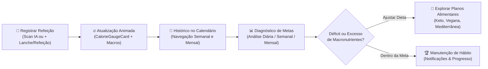
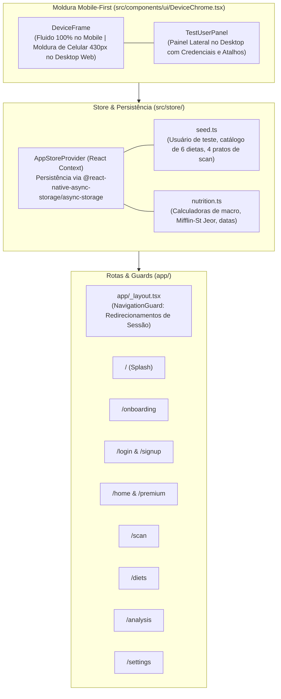

# 🥗 Nutri AI — Estudo de Caso & Documentação Técnica (`nutri-ai`)

> **Resumo Executivo:** O **Nutri AI Food Calorie Tracker App** é uma aplicação multiplataforma (Web, iOS e Android) construída com **React Native (0.88), Expo SDK 58, Expo Router, NativeWind v4 e TypeScript**. O projeto traduz e implementa fielmente em Português (PT-BR) **100% do Design System e das 47 telas** do protótipo oficial do Figma com arquitetura **Mobile-First**, camada completa de persistência local (`AsyncStorage`), usuário de teste para validação ponta a ponta, contadores animados em tempo real, gráficos vetoriais em SVG, calendário interativo funcional e alternância entre fluxo limpo mobile e **Modo Portfólio / Telas do Figma**.

---

## 📌 Sumário

1. [Visão Geral e Problema de Negócio](#-1-visão-geral-e-problema-de-negócio)
2. [A Solução: Ciclo de Engajamento e Nutrição Inteligente](#-2-a-solução-ciclo-de-engajamento-e-nutrição-inteligente)
3. [Casos de Uso e Cenário do Usuário de Teste](#-3-casos-de-uso-e-cenário-do-usuário-de-teste)
4. [Regras de Negócio, Cálculos Nutricionais e Motor de Animação](#-4-regras-de-negócio-cálculos-nutricionais-e-motor-de-animação)
5. [Arquitetura Modular, Mobile-First e Camada de Estado](#-5-arquitetura-modular-mobile-first-e-camada-de-estado)
6. [Catálogo de Componentes e Módulos (47 Telas)](#-6-catálogo-de-componentes-e-módulos-47-telas)
7. [Design System, Paleta de Cores e Tipografia](#-7-design-system-paleta-de-cores-e-tipografia)
8. [Decisões Técnicas (ADRs)](#-8-decisões-técnicas-adrs)
9. [Como Executar e Testar o Cenário](#-9-como-executar-e-testar-o-cenário)

---

## 🎯 1. Visão Geral e Problema de Negócio

### O Problema
Aplicativos tradicionais de contagem de calorias e acompanhamento nutricional costumam sofrer com altas taxas de abandono nas primeiras semanas de uso devido a três fatores críticos:
- **Fricção no registro manual de refeições:** digitar ingrediente por ingrediente e estimar gramaturas manualmente exige tempo e gera fadiga no usuário.
- **Visualização complexa e pouco acionável:** tabelas densas de macronutrientes dificultam entender rapidamente *quanto ainda resta* da meta diária de calorias, carboidratos, proteínas e gorduras.
- **Falta de conexão entre análise e plano alimentar:** o usuário descobre que está abaixo da meta de proteína, mas não recebe sugestões práticas de cardápios adaptados ao seu perfil (Vegano, Cetogênico, Mediterrâneo, Low Carb).

### A Proposta de Valor do `Nutri AI`
Transformar o acompanhamento nutricional diário em uma experiência visual, fluida e assistida por Inteligência Artificial:
1. **Reconhecimento Instantâneo por Câmera IA ([`ScanFlowScreen.tsx`](file:///Volumes/crucial-x9/ideias/nutri-ai/src/modules/scan/screens/ScanFlowScreen.tsx)):** o usuário aponta a câmera para o prato, visualiza o escaneamento em tempo real e recebe a decomposição automática de calorias e macronutrientes por ingrediente, podendo registrá-lo diretamente no diário.
2. **Dashboard Diário com Feedback Animado ([`HomeAndNotificationsScreen.tsx`](file:///Volumes/crucial-x9/ideias/nutri-ai/src/modules/home-premium/screens/HomeAndNotificationsScreen.tsx)):** um medidor semicircular em SVG ([`CalorieGaugeCard`](file:///Volumes/crucial-x9/ideias/nutri-ai/src/modules/home-premium/components/CalorieGaugeCard.tsx)) e cartões coloridos de alto contraste exibem o saldo calórico e a evolução de carboidratos e proteínas conforme a data selecionada no calendário funcional.
3. **Análise Histórica & Planos de Dieta ([`AnalysisScreen.tsx`](file:///Volumes/crucial-x9/ideias/nutri-ai/src/modules/analysis/screens/AnalysisScreen.tsx) & [`DietsFlowScreen.tsx`](file:///Volumes/crucial-x9/ideias/nutri-ai/src/modules/diets/screens/DietsFlowScreen.tsx)):** curvas comparativas de metas vs. consumo real (Diário, Semanal e Mensal) integradas a um catálogo de dietas completas com cardápios detalhados e possibilidade de adicionar a "Minhas Dietas".

---

## 💡 2. A Solução: Ciclo de Engajamento e Nutrição Inteligente

O fluxo central do produto opera como um ciclo contínuo de acompanhamento e ajuste nutricional:



---

## 📋 3. Casos de Uso e Cenário do Usuário de Teste

### Credenciais Fixas do Usuário de Teste

| Campo | Valor de Teste | Descrição |
| :--- | :--- | :--- |
| **E-mail** | `teste@nutriai.com` | Conta padrão pré-semeada com perfil, histórico de 7 dias e metas calculadas |
| **Senha** | `Nutri@123` | Validação de força (mínimo 8 caracteres, maiúscula e número) |
| **Código OTP** | `123456` | Aceito em todas as telas de verificação de 6 dígitos |

### Cenário de Teste Ponta a Ponta (End-to-End Walkthrough)

1. **Splash & Onboarding (`/` e `/onboarding`):**
   - Ao acessar a aplicação, a Splash anima o logotipo e os stickers flutuantes.
   - O usuário toca em "Explorar Onboarding", percorre os 3 slides interativos e clica em "Começar Agora". O status `onboardingSeen` é salvo localmente.
2. **Login com Credenciais de Teste (`/login`):**
   - A tela de Login apresenta um banner auxiliar mobile-first com as credenciais.
   - O usuário pode digitar `teste@nutriai.com` e `Nutri@123` (ou usar o botão "Preencher" / "1-Click").
   - Clicando em "Entrar", avança para a tela de Verificação OTP (`09_verification`) onde digita `123456` no teclado numérico oficial. Clicando em "Verificar", a sessão é iniciada e redirecionada para `/home`.
3. **Dashboard Home & Registro de Refeições (`/home`):**
   - A Home exibe a saudação `"Olá, Mariana"`, as metas diárias (`2.200 kcal`, `250g` carbos, `120g` proteínas) e o saldo restante.
   - O usuário clica em `+ Lanche (180 kcal)` ou `+ Refeição (380 kcal)`: a barra semicircular SVG e os contadores numéricos animam instantaneamente, e o item aparece na lista de refeições com botão de exclusão.
   - O usuário clica em qualquer data do calendário semanal ou abre o calendário mensal para ver o histórico correspondente.
4. **Escaneamento de Alimentos por IA (`/scan`):**
   - O visor da câmera IA exibe animação senoidal do laser de escaneamento.
   - O usuário pode tocar no botão "Alternar Prato" para focar em diferentes pratos (*Frango com Naan*, *Bowl de Salmão*, *Prato Feito*, *Salada Caesar*).
   - Ao disparar o obturador, o resultado decompõe os nutrientes e ingredientes. Ao clicar em "Registrar no Diário de Hoje", o prato é adicionado ao histórico e a tela retorna à Home.
5. **Exploração e Inscrição em Dietas (`/diets`):**
   - O usuário visualiza o catálogo com 6 dietas completas.
   - Clica em um card para abrir os detalhes, consulta os macronutrientes, o objetivo e clica em "Adicionar à Minha Dieta" ou "+ Registrar Refeição Deste Plano Hoje".
   - Na aba "Minhas Dietas", a dieta aparece listada.
6. **Análise Nutricional (`/analysis`):**
   - Nas abas *Diário*, *Semanal* e *Mensal*, o usuário visualiza gráficos SVG de tendência calórica e a distribuição percentual real calculada a partir dos alimentos registrados.
7. **Assinatura NutriAI Premium (`/premium`):**
   - O usuário seleciona o Plano Mensal ou Anual, escolhe o método de pagamento e confirma a assinatura. O usuário recebe a confirmação e o badge `PRO` dourado é exibido no perfil.
8. **Configurações, Perfil e Logout (`/settings`):**
   - O usuário pode editar seu nome, peso e altura (recalculando metas automaticamente), gerenciar notificações, alterar a senha ou ativar/desativar o **Modo Portfólio**.
   - Clicando em "Sair da Conta", um modal confirma o logout e retorna à tela de login.

---

## 🧮 4. Regras de Negócio, Cálculos Nutricionais e Motor de Animação

### 4.1. Geometria do Medidor Semicircular de Calorias (`CalorieGaugeCard`)
Em [`CalorieGaugeCard.tsx`](file:///Volumes/crucial-x9/ideias/nutri-ai/src/modules/home-premium/components/CalorieGaugeCard.tsx), o medidor de calorias utiliza um arco semicircular SVG de raio $r = 74\text{ px}$ centrado em $(95, 92)$. O comprimento total do arco (semicircunferência) e o deslocamento de preenchimento (`strokeDashoffset`) seguem as equações:

$$
C_{\text{semi}} = \pi \times r = \pi \times 74 \approx 232,48\text{ px}
$$

$$
\text{strokeDashoffset}(p) = C_{\text{semi}} \times \left(1 - \frac{\text{clamp}(p, 0, 100)}{100}\right)
$$

### 4.2. Interpolação Cúbica (`Cubic Ease-Out`) dos Contadores e Barras
Para garantir animações fluidas de 60fps tanto nos textos numéricos (`kcal` e `g`) quanto nos atributos SVG (`strokeDashoffset`) na Web e no Mobile, o hook [`useAnimatedNumber`](file:///Volumes/crucial-x9/ideias/nutri-ai/src/modules/home-premium/components/CalorieGaugeCard.tsx) interpola o valor inicial $V_0$ até o valor alvo $V_f$ ao longo de $D = 650\text{ ms}$ usando desaceleração cúbica:

$$
t = \min\left(1, \frac{\text{elapsed}}{D}\right), \quad \text{eased}(t) = 1 - (1 - t)^3
$$

$$
V(t) = V_0 + (V_f - V_0) \times \left(1 - (1 - t)^3\right)
$$

### 4.3. Cálculo de Metas por Mifflin-St Jeor (`estimateGoals`)
Em [`src/store/nutrition.ts`](file:///Volumes/crucial-x9/ideias/nutri-ai/src/store/nutrition.ts), as metas calóricas e de macronutrientes são recalculadas dinamicamente quando o usuário edita seu perfil:

$$
\text{TMB}_{\text{base}} = 10 \times \text{peso (kg)} + 6,25 \times \text{altura (cm)} - 5 \times \text{idade}
$$

$$
\text{TMB} = \begin{cases} \text{TMB}_{\text{base}} + 5 & \text{se Masculino} \\ \text{TMB}_{\text{base}} - 161 & \text{se Feminino/Outro} \end{cases}
$$

$$
\text{Meta Calórica} = \text{round}_{10}(\text{TMB} \times 1,375 \times 0,9)
$$

- **Carboidratos (45% da energia):** $\frac{\text{Calorias} \times 0,45}{4\text{ kcal/g}}$
- **Proteínas (25% da energia):** $\frac{\text{Calorias} \times 0,25}{4\text{ kcal/g}}$
- **Gorduras (30% da energia):** $\frac{\text{Calorias} \times 0,30}{9\text{ kcal/g}}$

---

## 🏗️ 5. Arquitetura Modular, Mobile-First e Camada de Estado

### Estrutura de Camadas



### Principais Características da Arquitetura:
1. **Layout Responsivo Mobile-First:**
   - Em smartphones (telas `< 700px`), a aplicação ocupa 100% da largura, respeitando safe areas (notch e barra inferior de gestos) com o componente [`Screen`](file:///Volumes/crucial-x9/ideias/nutri-ai/src/components/layout/Screen.tsx).
   - Em telas maiores (Desktop Web `>= 700px`), o componente [`DeviceFrame`](file:///Volumes/crucial-x9/ideias/nutri-ai/src/components/ui/DeviceChrome.tsx) renderiza uma elegante moldura de smartphone de 430px acompanhada do painel lateral [`TestUserPanel`](file:///Volumes/crucial-x9/ideias/nutri-ai/src/components/layout/Screen.tsx) com as credenciais de teste e status da sessão em tempo real.
2. **Modo Portfólio vs. Modo Funcional:**
   - No **Modo Funcional (padrão)**, a barra superior de portfólio e as pílulas de telas (`05_`, `23_`, `33_`) ficam ocultas, proporcionando uma experiência de usuário 100% limpa e realista.
   - No **Modo Portfólio**, ativado pelo toggle em Ajustes ou no painel lateral, as pílulas de navegação rápida reaparecem para permitir inspeção direta de cada estado do Figma.
3. **Persistência Local Automática:**
   - Utiliza `@react-native-async-storage/async-storage` com debounce de 250ms para gravar todas as refeições adicionadas, preferências de notificação, métodos de pagamento e status da assinatura.

---

## 🧩 6. Catálogo de Componentes e Módulos (47 Telas)

### Mapeamento Completo dos 9 Módulos (Telas `01` a `47`)

| Passo | Módulo (`src/modules/`) | Telas do Figma Implementadas | Rota no App |
| :---: | :--- | :--- | :--- |
| **1** | [`onboarding`](file:///Volumes/crucial-x9/ideias/nutri-ai/src/modules/onboarding/screens/SplashScreen.tsx) | `01_Splash Screen` | `/` |
| **2** | [`onboarding`](file:///Volumes/crucial-x9/ideias/nutri-ai/src/modules/onboarding/screens/OnboardingScreen.tsx) | `02_Onboarding Screen`, `03_Onboarding Screen`, `04_Onboarding Screen` | `/onboarding` |
| **3** | [`auth-login`](file:///Volumes/crucial-x9/ideias/nutri-ai/src/modules/auth-login/screens/LoginFlowScreen.tsx) | `05_Log in-Default`, `06_Log in-Error`, `07_Log in-Active`, `08_Log in-Fill`, `09_Verification`, `10_Forgot Password`, `11_Reset Password`, `12_Reset Password Modal` | `/login` |
| **4** | [`auth-signup`](file:///Volumes/crucial-x9/ideias/nutri-ai/src/modules/auth-signup/screens/SignUpFlowScreen.tsx) | `13_Sign Up-Default`, `14_Sign Up-Fill`, `15_Verification` | `/signup` |
| **5** | [`home-premium`](file:///Volumes/crucial-x9/ideias/nutri-ai/src/modules/home-premium/screens/HomeAndNotificationsScreen.tsx) | `16_Premium offer`, `17_Premium`, `18_Monthly Plan`, `19_Annual Plan`, `20_Payment`, `21_Review Summary`, `22_Congratulation`, `23_Home`, `24_Notification-Empty`, `25_Notification` | `/home` & `/premium` |
| **6** | [`analysis`](file:///Volumes/crucial-x9/ideias/nutri-ai/src/modules/analysis/screens/AnalysisScreen.tsx) | `26_Analysis` | `/analysis` |
| **7** | [`scan`](file:///Volumes/crucial-x9/ideias/nutri-ai/src/modules/scan/screens/ScanFlowScreen.tsx) | `31_Scanning`, `32_Scan Result` | `/scan` |
| **8** | [`diets`](file:///Volumes/crucial-x9/ideias/nutri-ai/src/modules/diets/screens/DietsFlowScreen.tsx) | `27_Diets`, `28_Diet details`, `29_My Diets-Empty`, `30_My Diets` | `/diets` |
| **9** | [`settings`](file:///Volumes/crucial-x9/ideias/nutri-ai/src/modules/settings/screens/SettingsFlowScreen.tsx) | `33_Settings`, `34_My Profile`, `35_Change Password`, `36_Password Changed`, `37_Notification`, `38_Payment Method`, `39_Add New Card`, `40_Favorite-empty`, `41_Favorite`, `42_More`, `43_Terms and Conditions`, `44_Privacy Policy`, `45_Help`, `46_Delete Account`, `47_Log out` | `/settings` |

---

## 🎨 7. Design System, Paleta de Cores e Tipografia

Todos os tokens visuais estão centralizados em [`src/theme/colors.ts`](file:///Volumes/crucial-x9/ideias/nutri-ai/src/theme/colors.ts), [`src/theme/typography.ts`](file:///Volumes/crucial-x9/ideias/nutri-ai/src/theme/typography.ts) e [`src/theme/shadows.ts`](file:///Volumes/crucial-x9/ideias/nutri-ai/src/theme/shadows.ts), espelhados no [`tailwind.config.js`](file:///Volumes/crucial-x9/ideias/nutri-ai/tailwind.config.js).

### Paleta de Cores Oficial (Figma Node `105:191`)

| Token (`colors.*`) | Hexadecimal | Uso Semântico na Interface |
| :--- | :--- | :--- |
| `primary[100]` | `#FF5A16` | Laranja vibrante principal (CTAs, links, estados ativos, destaques) |
| `message.green` (`100`) | `#04B155` | Feedback de sucesso e confirmação |
| `message.red` (`200`) | `#C93838` | Bordas de erro em inputs, alertas destrutivos (*Sair*, *Excluir Conta*) |
| `grayscale[100]` | `#FFFFFF` | Títulos principais, textos em destaque e superfícies claras (Calendário) |
| `grayscale[200]` | `#C3C3C3` | Subtítulos, textos secundários e placeholders |
| `grayscale[300]` | `#474747` | Controles desabilitados e trilhas inativas de toggles |
| `grayscale[400]` | `#2F2F2F` | Bordas de cards, divisores e superfícies elevadas |
| `grayscale[500]` | `#232220` | Superfície padrão de cards escuros, botões circulares e menus |
| `grayscale[600]` | `#121212` | Fundo principal das telas do aplicativo (*Dark Background*) |
| `accent[100]` | `#DDC0FF` | Lilás pastel (Card de Calorias na Home, dia ativo no calendário) |
| `accent[200]` | `#F5F378` | Amarelo pastel (Card de Carboidratos, Distribuição de Macros, chips ativos) |
| `accent[300]` | `#45C588` | Verde menta (Card de Proteínas, indicadores de meta atingida) |
| `accent[400]` | `#FF6F43` | Coral vibrante (Curva de calorias e barra de Gorduras) |

---

## 🛠️ 8. Decisões Técnicas (ADRs)

### ADR 01: Arquitetura Modular por Domínio (`src/modules/*`) + Barra de Portfólio
- **Decisão:** Isolar cada domínio em `src/modules/<modulo>/` e criar seletores condicionais controlados pelo estado `demoMode`.
- **Resultado:** O usuário pode navegar organicamente pelo aplicativo funcionalmente ou alternar para o modo portfólio para inspecionar cada variação de tela do Figma.

### ADR 02: Design Tokens Tipados + NativeWind v4 (`darkMode: "class"`)
- **Decisão:** Centralizar cores, fontes e raios em TypeScript `as const` com `darkMode: "class"` no Tailwind.
- **Resultado:** Zero erros de runtime no `react-native-css-interop` na Web e consistência visual total.

### ADR 03: Motor de Animação Híbrido Web & Mobile
- **Decisão:** Utilizar `useNativeDriver: Platform.OS !== "web"` e `useAnimatedNumber` com curva *Cubic Ease-Out* baseada em `requestAnimationFrame`.
- **Resultado:** Contadores numéricos e arcos SVG animados a 60fps sem warnings no console.

### ADR 04: Atualização para Expo SDK 58 (`React 19.3` + `React Native 0.88`)
- **Decisão:** Atualizar dependências para Expo SDK 58 com `web.output: "single"`.
- **Resultado:** Suporte imediato ao aplicativo Expo Go mais recente e build estático para portfólio web.

### ADR 05: Abordagem Mobile-First com Moldura Responsiva e Persistência Local
- **Decisão:** Implementar [`DeviceFrame`](file:///Volumes/crucial-x9/ideias/nutri-ai/src/components/ui/DeviceChrome.tsx) (largura 100% em celulares e moldura de smartphone de 430px com painel lateral em desktops) e persistência via `@react-native-async-storage/async-storage`.
- **Resultado:** O avaliador pode testar o app em tela cheia no smartphone ou em tela de desktop com visual de produto real e dados mantidos entre recarregamentos.

---

## 🚀 9. Como Executar e Testar o Cenário

### Pré-requisitos
- **Node.js** (v20+ ou v22 LTS)
- **NPM**

### Instalação e Execução

```bash
# 1. Acesse a pasta do projeto
cd nutri-ai

# 2. Instale as dependências
npm install --legacy-peer-deps

# 3. Inicie no navegador Web (Portfólio) com cache limpo
npx expo start --web -c

# 4. Ou inicie o servidor Expo para abrir no Expo Go (iOS / Android)
npm start
```

### Acesso Rápido no Navegador
- **App Principal (Mobile-First):** `http://localhost:8081`
- **Style Guide Interativo:** `http://localhost:8081/style-guide`
