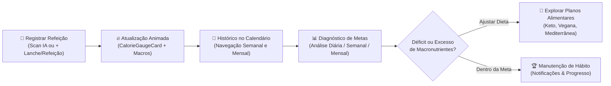
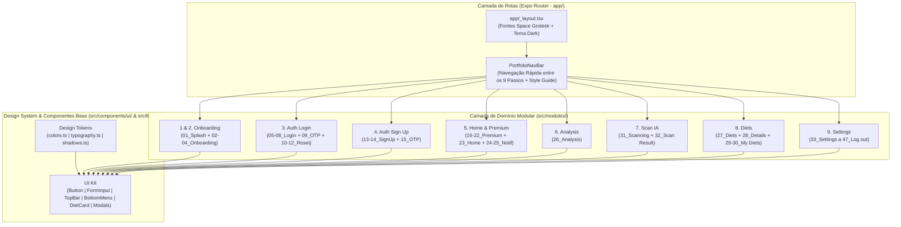

# 🥗 Nutri AI — Estudo de Caso & Documentação Técnica (`nutri-ai`)

> **Resumo Executivo:** O **Nutri AI Food Calorie Tracker App** é uma aplicação multiplataforma (Web, iOS e Android) construída com **React Native (0.88), Expo SDK 58, Expo Router, NativeWind v4 e TypeScript**. O projeto traduz e implementa fielmente em Português (PT-BR) **100% do Design System e das 47 telas** do protótipo oficial do Figma, adicionando contadores animados em tempo real, gráficos vetoriais em SVG, calendário interativo funcional, simulação de escaneamento alimentar por IA e uma barra de navegação dedicada para demonstração em portfólio web.

---

## 📌 Sumário

1. [Visão Geral e Problema de Negócio](#-1-visão-geral-e-problema-de-negócio)
2. [A Solução: Ciclo de Engajamento e Nutrição Inteligente](#-2-a-solução-ciclo-de-engajamento-e-nutrição-inteligente)
3. [Casos de Uso (Use Cases)](#-3-casos-de-uso-use-cases)
4. [Regras de Negócio, Cálculos Nutricionais e Motor de Animação](#-4-regras-de-negócio-cálculos-nutricionais-e-motor-de-animação)
5. [Arquitetura Modular e Fluxo de Dados](#-5-arquitetura-modular-e-fluxo-de-dados)
6. [Catálogo de Componentes e Módulos (47 Telas)](#-6-catálogo-de-componentes-e-módulos-47-telas)
7. [Design System, Paleta de Cores e Tipografia](#-7-design-system-paleta-de-cores-e-tipografia)
8. [Decisões Técnicas (ADRs)](#-8-decisões-técnicas-adrs)
9. [Como Executar o Projeto](#-9-como-executar-o-projeto)

---

## 🎯 1. Visão Geral e Problema de Negócio

### O Problema
Aplicativos tradicionais de contagem de calorias e acompanhamento nutricional costumam sofrer com altas taxas de abandono nas primeiras semanas de uso devido a três fatores críticos:
- **Fricção no registro manual de refeições:** digitar ingrediente por ingrediente e estimar gramaturas manualmente exige tempo e gera fadiga no usuário.
- **Visualização complexa e pouco acionável:** tabelas densas de macronutrientes dificultam entender rapidamente *quanto ainda resta* da meta diária de calorias, carboidratos, proteínas e gorduras.
- **Falta de conexão entre análise e plano alimentar:** o usuário descobre que está abaixo da meta de proteína, mas não recebe sugestões práticas de cardápios adaptados ao seu perfil (Vegano, Cetogênico, Mediterrâneo, Low Carb).

### A Proposta de Valor do `Nutri AI`
Transformar o acompanhamento nutricional diário em uma experiência visual, fluida e assistida por Inteligência Artificial:
1. **Reconhecimento Instantâneo por Câmera IA ([`ScanFlowScreen.tsx`](file:///Volumes/crucial-x9/ideias/nutri-ai/src/modules/scan/screens/ScanFlowScreen.tsx)):** o usuário aponta a câmera para o prato, visualiza o escaneamento em tempo real e recebe a decomposição automática de calorias e macronutrientes por ingrediente.
2. **Dashboard Diário com Feedback Animado ([`HomeAndNotificationsScreen.tsx`](file:///Volumes/crucial-x9/ideias/nutri-ai/src/modules/home-premium/screens/HomeAndNotificationsScreen.tsx)):** um medidor semicircular em SVG ([`CalorieGaugeCard`](file:///Volumes/crucial-x9/ideias/nutri-ai/src/modules/home-premium/components/CalorieGaugeCard.tsx)) e cartões coloridos de alto contraste exibem o saldo calórico e a evolução de carboidratos e proteínas conforme a data selecionada no calendário.
3. **Análise Histórica & Planos de Dieta ([`AnalysisScreen.tsx`](file:///Volumes/crucial-x9/ideias/nutri-ai/src/modules/analysis/screens/AnalysisScreen.tsx) & [`DietsFlowScreen.tsx`](file:///Volumes/crucial-x9/ideias/nutri-ai/src/modules/diets/screens/DietsFlowScreen.tsx)):** curvas comparativas de metas vs. excessos (Diário, Semanal e Mensal) integradas a um catálogo de dietas completas com cardápios detalhados e receitas passo a passo.

---

## 💡 2. A Solução: Ciclo de Engajamento e Nutrição Inteligente

O fluxo central do produto opera como um ciclo contínuo de acompanhamento e ajuste nutricional:



---

## 📋 3. Casos de Uso (Use Cases)

### Matriz de Casos de Uso Extraídos do Código

| ID | Caso de Uso | Ator | Módulo / Arquivo Principal |
| :--- | :--- | :--- | :--- |
| **UC01** | Explorar o Design System interativo (Cores, Tipografia, Botões, Inputs, Elementos) | Visitante / Recrutador | [`app/style-guide.tsx`](file:///Volumes/crucial-x9/ideias/nutri-ai/app/style-guide.tsx) |
| **UC02** | Visualizar a Splash animada e percorrer os 3 passos de Onboarding | Usuário | [`SplashScreen.tsx`](file:///Volumes/crucial-x9/ideias/nutri-ai/src/modules/onboarding/screens/SplashScreen.tsx) / [`OnboardingScreen.tsx`](file:///Volumes/crucial-x9/ideias/nutri-ai/src/modules/onboarding/screens/OnboardingScreen.tsx) |
| **UC03** | Autenticar-se (estados Default, Active, Fill, Error), validar OTP e redefinir senha | Usuário | [`LoginFlowScreen.tsx`](file:///Volumes/crucial-x9/ideias/nutri-ai/src/modules/auth-login/screens/LoginFlowScreen.tsx) |
| **UC04** | Criar nova conta com validação de termos e verificação OTP por teclado numérico | Usuário | [`SignUpFlowScreen.tsx`](file:///Volumes/crucial-x9/ideias/nutri-ai/src/modules/auth-signup/screens/SignUpFlowScreen.tsx) |
| **UC05** | Navegar pelo calendário (semanal/mensal) e simular refeições com contadores animados | Usuário | [`HomeAndNotificationsScreen.tsx`](file:///Volumes/crucial-x9/ideias/nutri-ai/src/modules/home-premium/screens/HomeAndNotificationsScreen.tsx) |
| **UC06** | Assinar o plano NutriAI Premium (Mensal/Anual), escolher método de pagamento e revisar resumo | Usuário | [`PremiumFlowScreen.tsx`](file:///Volumes/crucial-x9/ideias/nutri-ai/src/modules/home-premium/screens/PremiumFlowScreen.tsx) |
| **UC07** | Inspecionar gráficos de progresso calórico e distribuição de macros por período | Usuário | [`AnalysisScreen.tsx`](file:///Volumes/crucial-x9/ideias/nutri-ai/src/modules/analysis/screens/AnalysisScreen.tsx) |
| **UC08** | Escanear refeição via câmera IA e consultar decomposição nutricional dos ingredientes | Usuário | [`ScanFlowScreen.tsx`](file:///Volumes/crucial-x9/ideias/nutri-ai/src/modules/scan/screens/ScanFlowScreen.tsx) |
| **UC09** | Explorar planos de dieta, consultar receitas detalhadas, favoritar e compartilhar cardápios | Usuário | [`DietsFlowScreen.tsx`](file:///Volumes/crucial-x9/ideias/nutri-ai/src/modules/diets/screens/DietsFlowScreen.tsx) |
| **UC10** | Gerenciar perfil, alterar senha, configurar notificações, cartões, termos legais e sessão | Usuário | [`SettingsFlowScreen.tsx`](file:///Volumes/crucial-x9/ideias/nutri-ai/src/modules/settings/screens/SettingsFlowScreen.tsx) |

---

### Detalhamento dos Principais Fluxos de Uso

#### **UC02 — Splash Screen & Onboarding Interativo (Telas `01` a `04`)**
- **Pré-condição:** Usuário acessa a rota inicial `/` ([`app/index.tsx`](file:///Volumes/crucial-x9/ideias/nutri-ai/app/index.tsx)) ou `/onboarding` ([`app/onboarding.tsx`](file:///Volumes/crucial-x9/ideias/nutri-ai/app/onboarding.tsx)).
- **Fluxo Principal:**
  1. Na [`SplashScreenView`](file:///Volumes/crucial-x9/ideias/nutri-ai/src/modules/onboarding/screens/SplashScreen.tsx#L32-L76), o logotipo [`NutriLogo`](file:///Volumes/crucial-x9/ideias/nutri-ai/src/components/ui/Logo.tsx) surge com animação *Spring*, enquanto os 8 stickers vetoriais oficiais do Figma flutuam continuamente em senoides independentes através do wrapper [`AnimatedFloatingNode`](file:///Volumes/crucial-x9/ideias/nutri-ai/src/modules/onboarding/components/AnimatedFloatingNode.tsx).
  2. Ao tocar em qualquer sticker, o componente executa um efeito elástico de *bounce* (`scale: 1 -> 1.18 -> 1`).
  3. Ao avançar para [`OnboardingScreenView`](file:///Volumes/crucial-x9/ideias/nutri-ai/src/modules/onboarding/screens/OnboardingScreen.tsx#L193-L258), o usuário navega pelos 3 slides (*"Monitore Calorias Sem Esforço"*, *"Planos de Dieta Sob Medida"* e *"Análise Nutricional Inteligente"*) ou utiliza os seletores rápidos no topo para inspecionar cada etapa.

#### **UC03 & UC04 — Autenticação, Recuperação de Senha e Cadastro (Telas `05` a `15`)**
- **Fluxo Principal:**
  1. Em [`LoginFlowScreen`](file:///Volumes/crucial-x9/ideias/nutri-ai/src/modules/auth-login/screens/LoginFlowScreen.tsx), o usuário pode alternar instantaneamente entre os 8 estados desenhados no Figma: `05_Default`, `06_Error` (validação visual em `#C93838`), `07_Active` (borda `#FFFFFF`), `08_Fill`, `09_Verification` (OTP de 4 dígitos com teclado numérico customizado [`NumericKeypad`](file:///Volumes/crucial-x9/ideias/nutri-ai/src/modules/auth-login/components/NumericKeypad.tsx)), `10_Forgot Password`, `11_Reset Password` e `12_Reset Password Modal`.
  2. Em [`SignUpFlowScreen`](file:///Volumes/crucial-x9/ideias/nutri-ai/src/modules/auth-signup/screens/SignUpFlowScreen.tsx), o usuário preenche nome, e-mail, senha e aceite de Termos (`13_Sign Up-Default` e `14_Sign Up-Fill`) e valida o código enviado por e-mail (`15_Verification`).

#### **UC05 — Dashboard Home, Calendário Funcional e Simulação de Refeições (Telas `23` a `25`)**
- **Fluxo Principal:**
  1. Ao abrir `/home` ([`HomeAndNotificationsScreen.tsx`](file:///Volumes/crucial-x9/ideias/nutri-ai/src/modules/home-premium/screens/HomeAndNotificationsScreen.tsx#L173-L263)), o calendário inicia posicionado no dia **11 de Outubro de 2026**, exibindo os valores de referência do Figma (`1.672 kcal` restantes, `72%` concluído, `140g/200g` de carboidratos e `60g/120g` de proteínas).
  2. O usuário pode navegar entre semanas (`<` / `>`), clicar em qualquer dia da faixa semanal branca (`Seg` a `Dom`) ou abrir o **Calendário Mensal Completo** (`Botão Mês`) para selecionar qualquer data do ano.
  3. A cada troca de data — ou ao clicar nos botões de simulação rápida **`+ Lanche (+180 kcal)`** e **`+ Refeição (+380 kcal)`** — o arco SVG e os contadores numéricos animam suavemente até os novos valores, atualizando também o card de **Plano Alimentar do Dia**.
- **Fluxo Alternativo (Notificações):**
  1. Ao tocar no ícone de sino no cabeçalho, a tela alterna para a central de notificações preenchida (`25_Notification`) ou seu estado vazio (`24_Notification-Empty`).

#### **UC06 — Fluxo de Assinatura NutriAI Premium (Telas `16` a `22`)**
- **Fluxo Principal:**
  1. A partir do ícone de coroa dourada na Home ou pela rota `/premium` ([`PremiumFlowScreen.tsx`](file:///Volumes/crucial-x9/ideias/nutri-ai/src/modules/home-premium/screens/PremiumFlowScreen.tsx)), o usuário visualiza o modal de oferta (`16_Premium offer`), compara benefícios na vitrine (`17_Premium`), seleciona entre Plano Mensal (`R$ 24,90/mês` — `18_Monthly Plan`) ou Plano Anual (`R$ 249,90/ano` — `19_Annual Plan`), escolhe o meio de pagamento (`Google Pay`, `Apple Pay` ou `Visa` — `20_Payment`), confere o resumo da assinatura (`21_Review Summary`) e recebe a tela de confirmação (`22_Congratulation`).

#### **UC08 — Escaneamento de Refeições por IA (Telas `31` e `32`)**
- **Fluxo Principal:**
  1. Na tela `31_Scanning` ([`ScanFlowScreen.tsx`](file:///Volumes/crucial-x9/ideias/nutri-ai/src/modules/scan/screens/ScanFlowScreen.tsx#L87-L117)), o visor da câmera exibe cantoneiras de foco e uma linha de laser animada em loop senoidal contínuo sobre o prato.
  2. Ao acionar o obturador (ou alternar para `32_Scan Result`), um *bottom sheet* apresenta os alimentos reconhecidos pela IA (*Tiras de Frango Grelhado*, *Pão Naan Artesanal*, *Pimentões Salteados*) e os cartões de progresso de Carboidratos (`50%`), Proteínas (`83%`), Calorias (`620 kcal`) e Gorduras (`38%`).

---

## 🧮 4. Regras de Negócio, Cálculos Nutricionais e Motor de Animação

### 4.1. Geometria do Medidor Semicircular de Calorias (`CalorieGaugeCard`)
Em [`CalorieGaugeCard.tsx`](file:///Volumes/crucial-x9/ideias/nutri-ai/src/modules/home-premium/components/CalorieGaugeCard.tsx#L64-L98), o medidor de calorias utiliza um arco semicircular SVG de raio $r = 74\text{ px}$ centrado em $(95, 92)$. O comprimento total do arco (semicircunferência) e o deslocamento de preenchimento (`strokeDashoffset`) seguem as equações:

$$
C_{\text{semi}} = \pi \times r = \pi \times 74 \approx 232,48\text{ px}
$$

$$
\text{strokeDashoffset}(p) = C_{\text{semi}} \times \left(1 - \frac{\text{clamp}(p, 0, 100)}{100}\right)
$$

Onde $p$ é o percentual de progresso animado em cada frame.

### 4.2. Interpolação Cúbica (`Cubic Ease-Out`) dos Contadores e Barras
Para garantir animações fluidas de 60fps tanto nos textos numéricos (`kcal` e `g`) quanto nos atributos SVG (`strokeDashoffset`) na Web e no Mobile, o hook [`useAnimatedNumber`](file:///Volumes/crucial-x9/ideias/nutri-ai/src/modules/home-premium/components/CalorieGaugeCard.tsx#L10-L47) interpola o valor inicial $V_0$ até o valor alvo $V_f$ ao longo de $D = 650\text{ ms}$ usando desaceleração cúbica:

$$
t = \min\left(1, \frac{\text{elapsed}}{D}\right), \quad \text{eased}(t) = 1 - (1 - t)^3
$$

$$
V(t) = V_0 + (V_f - V_0) \times \left(1 - (1 - t)^3\right)
$$

### 4.3. Motor Determinístico de Nutrição por Data no Calendário
Em [`HomeAndNotificationsScreen.tsx`](file:///Volumes/crucial-x9/ideias/nutri-ai/src/modules/home-premium/screens/HomeAndNotificationsScreen.tsx#L109-L147), qualquer data selecionada $(Y, M, D)$ gera um perfil nutricional consistente através de uma semente determinística:

$$
\text{seed} = 372Y + 31M + D
$$

| Métrica | Dia Padrão Figma (`11/10/2026`) | Outras Datas do Calendário (`seed`) | Incremento Rápido (`+ Lanche` / `+ Refeição`) |
| :--- | :---: | :---: | :---: |
| **Meta Diária (`caloriesGoal`)** | `2.200 kcal` | `2.200 kcal` | Mantém `2.200 kcal` |
| **Calorias Consumidas** | `528 kcal` (`72%` visual) | $350 + (\text{seed} \times 173 \bmod 1570)\text{ kcal}$ | `+180 kcal` ou `+380 kcal` |
| **Calorias Restantes** | **`1.672 kcal`** | $\max(0, 2200 - \text{Consumidas})$ | Recalculado e animado em tempo real |
| **Carboidratos (`carbsGrams`)** | **`140g` / `200g`** | $55 + (\text{seed} \times 47 \bmod 140)\text{ g}$ | `+22g` ou `+38g` |
| **Proteínas (`proteinGrams`)** | **`60g` / `120g`** | $38 + (\text{seed} \times 29 \bmod 80)\text{ g}$ | `+14g` ou `+28g` |

---

## 🏗️ 5. Arquitetura Modular e Fluxo de Dados

### Diagrama de Arquitetura e Navegação entre Módulos



---

## 🧩 6. Catálogo de Componentes e Módulos (47 Telas)

### 6.1. Biblioteca de Componentes Base (`src/components/ui/`)
- **[`Typography.tsx`](file:///Volumes/crucial-x9/ideias/nutri-ai/src/components/ui/Typography.tsx) (`AppText`):** Componente tipográfico polimórfico que aplica automaticamente as 12 variantes da família **Space Grotesk** definidas no Style Guide.
- **[`Button.tsx`](file:///Volumes/crucial-x9/ideias/nutri-ai/src/components/ui/Button.tsx):** Contém [`Button`](file:///Volumes/crucial-x9/ideias/nutri-ai/src/components/ui/Button.tsx#L29-L108) (`primary`, `secondary`, `outline` nos tamanhos `large`, `medium`, `small`), [`SocialButton`](file:///Volumes/crucial-x9/ideias/nutri-ai/src/components/ui/Button.tsx#L118-L162) (Google e Apple), [`CircleIconButton`](file:///Volumes/crucial-x9/ideias/nutri-ai/src/components/ui/Button.tsx#L174-L216), [`IconBoxButton`](file:///Volumes/crucial-x9/ideias/nutri-ai/src/components/ui/Button.tsx#L223-L250) e [`ViewAllButton`](file:///Volumes/crucial-x9/ideias/nutri-ai/src/components/ui/Button.tsx#L256-L280).
- **[`Input.tsx`](file:///Volumes/crucial-x9/ideias/nutri-ai/src/components/ui/Input.tsx):** Contém [`FormInput`](file:///Volumes/crucial-x9/ideias/nutri-ai/src/components/ui/Input.tsx#L38-L194) (com suporte a estados `default`, `active`, `field`, `error`, `disabled`, máscara de senha e DDI telefônico), [`SearchInput`](file:///Volumes/crucial-x9/ideias/nutri-ai/src/components/ui/Input.tsx#L200-L230), [`DropdownField`](file:///Volumes/crucial-x9/ideias/nutri-ai/src/components/ui/Input.tsx#L236-L333) e [`TextAreaField`](file:///Volumes/crucial-x9/ideias/nutri-ai/src/components/ui/Input.tsx#L339-L428).
- **[`SelectionControls.tsx`](file:///Volumes/crucial-x9/ideias/nutri-ai/src/components/ui/SelectionControls.tsx):** Contém [`Toggle`](file:///Volumes/crucial-x9/ideias/nutri-ai/src/components/ui/SelectionControls.tsx#L13-L48) (`normal` 51x31 e `small` 40x22), [`Checkbox`](file:///Volumes/crucial-x9/ideias/nutri-ai/src/components/ui/SelectionControls.tsx#L54-L102), [`RadioButton`](file:///Volumes/crucial-x9/ideias/nutri-ai/src/components/ui/SelectionControls.tsx#L108-L154) e [`FilterChip`](file:///Volumes/crucial-x9/ideias/nutri-ai/src/components/ui/SelectionControls.tsx#L160-L189).
- **[`Navigation.tsx`](file:///Volumes/crucial-x9/ideias/nutri-ai/src/components/ui/Navigation.tsx):** Contém [`StatusBarMock`](file:///Volumes/crucial-x9/ideias/nutri-ai/src/components/ui/Navigation.tsx#L13-L41), [`HomeIndicator`](file:///Volumes/crucial-x9/ideias/nutri-ai/src/components/ui/Navigation.tsx#L46-L72), [`TopBar`](file:///Volumes/crucial-x9/ideias/nutri-ai/src/components/ui/Navigation.tsx#L78-L125), [`SegmentedTabs`](file:///Volumes/crucial-x9/ideias/nutri-ai/src/components/ui/Navigation.tsx#L131-L186) (variantes `period` de 3 abas e `diet` de 2 abas) e [`BottomMenu`](file:///Volumes/crucial-x9/ideias/nutri-ai/src/components/ui/Navigation.tsx#L192-L246) flutuante com 5 abas.
- **[`Elements.tsx`](file:///Volumes/crucial-x9/ideias/nutri-ai/src/components/ui/Elements.tsx):** Contém [`OTPInput`](file:///Volumes/crucial-x9/ideias/nutri-ai/src/components/ui/Elements.tsx#L22-L81), [`RangeSlider`](file:///Volumes/crucial-x9/ideias/nutri-ai/src/components/ui/Elements.tsx#L87-L174), [`ProfileAvatar`](file:///Volumes/crucial-x9/ideias/nutri-ai/src/components/ui/Elements.tsx#L181-L261), [`NotificationCard`](file:///Volumes/crucial-x9/ideias/nutri-ai/src/components/ui/Elements.tsx#L268-L324), [`PaymentMethodCard`](file:///Volumes/crucial-x9/ideias/nutri-ai/src/components/ui/Elements.tsx#L382-L422), [`DietCard`](file:///Volumes/crucial-x9/ideias/nutri-ai/src/components/ui/Elements.tsx#L430-L533), [`MessageModalCard`](file:///Volumes/crucial-x9/ideias/nutri-ai/src/components/ui/Elements.tsx#L540-L628), [`DatePickerCard`](file:///Volumes/crucial-x9/ideias/nutri-ai/src/components/ui/Elements.tsx#L636-L772) e [`ShareSheetCard`](file:///Volumes/crucial-x9/ideias/nutri-ai/src/components/ui/Elements.tsx#L780-L892).

### 6.2. Mapeamento Completo dos 9 Módulos (Telas `01` a `47`)

| Passo | Módulo (`src/modules/`) | Telas do Figma Implementadas | Rota no App |
| :---: | :--- | :--- | :--- |
| **1** | [`onboarding`](file:///Volumes/crucial-x9/ideias/nutri-ai/src/modules/onboarding/screens/SplashScreen.tsx) | `01_Splash Screen` | `/` |
| **2** | [`onboarding`](file:///Volumes/crucial-x9/ideias/nutri-ai/src/modules/onboarding/screens/OnboardingScreen.tsx) | `02_Onboarding Screen`, `03_Onboarding Screen`, `04_Onboarding Screen` | `/onboarding` |
| **3** | [`auth-login`](file:///Volumes/crucial-x9/ideias/nutri-ai/src/modules/auth-login/screens/LoginFlowScreen.tsx) | `05_Log in-Default`, `06_Log in-Error`, `07_Log in-Active`, `08_Log in-Fill`, `09_Verification`, `10_Forgot Password`, `11_Reset Password`, `12_Reset Password Modal` | `/login` |
| **4** | [`auth-signup`](file:///Volumes/crucial-x9/ideias/nutri-ai/src/modules/auth-signup/screens/SignUpFlowScreen.tsx) | `13_Sign Up-Default`, `14_Sign Up-Fill`, `15_Verification` | `/signup` |
| **5** | [`home-premium`](file:///Volumes/crucial-x9/ideias/nutri-ai/src/modules/home-premium/screens/HomeAndNotificationsScreen.tsx) | `16_Premium offer`, `17_Premium`, `18_Monthly Plan`, `19_Annual Plan`, `20_Payment`, `21_Review Summary`, `22_Congratulation`, `23_Home`, `24_Notification-Empty`, `25_Notification` | `/home` & `/premium` |
| **6** | [`analysis`](file:///Volumes/crucial-x9/ideias/nutri-ai/src/modules/analysis/screens/AnalysisScreen.tsx) | `26_Analysis` | `/analysis` |
| **7** | [`scan`](file:///Volumes/crucial-x9/ideias/nutri-ai/src/modules/scan/screens/ScanFlowScreen.tsx) | `31_Scanning`, `32_Scan Result` | `/scan` |
| **8** | [`diets`](file:///Volumes/crucial-x9/ideias/nutri-ai/src/modules/diets/screens/DietsFlowScreen.tsx) | `27_Diets`, `28_Diet details`, `29_My Diets-Empty`, `30_My Diets` | `/diets` |
| **9** | [`settings`](file:///Volumes/crucial-x9/ideias/nutri-ai/src/modules/settings/screens/SettingsFlowScreen.tsx) | `33_Settings`, `34_My Profile`, `35_Change Password`, `36_Password Changed`, `37_Notification`, `38_Payment Method`, `39_Add New Card`, `40_Favorite-empty`, `41_Favorite`, `42_More`, `43_Terms and Conditions`, `44_Privacy Policy`, `45_Help`, `46_Delete Account`, `47_Log out` | `/settings` |

---

## 🎨 7. Design System, Paleta de Cores e Tipografia

Todos os tokens visuais estão centralizados e fortemente tipados em [`src/theme/colors.ts`](file:///Volumes/crucial-x9/ideias/nutri-ai/src/theme/colors.ts), [`src/theme/typography.ts`](file:///Volumes/crucial-x9/ideias/nutri-ai/src/theme/typography.ts) e [`src/theme/shadows.ts`](file:///Volumes/crucial-x9/ideias/nutri-ai/src/theme/shadows.ts), espelhados no [`tailwind.config.js`](file:///Volumes/crucial-x9/ideias/nutri-ai/tailwind.config.js).

### 7.1. Paleta de Cores Oficial (Figma Node `105:191`)

| Token (`colors.*`) | Hexadecimal | Uso Semântico na Interface |
| :--- | :--- | :--- |
| `primary[100]` | `#FF5A16` | Laranja vibrante principal (CTAs, links, estados ativos, destaques) |
| `message.green` (`100`) | `#04B155` | Feedback de sucesso e confirmação |
| `message.red` (`200`) | `#C93838` | Bordas de erro em inputs, alertas destrutivos (*Sair*, *Excluir Conta*) |
| `grayscale[100]` | `#FFFFFF` | Títulos principais, textos em destaque e superfícies claras (Calendário) |
| `grayscale[200]` | `#C3C3C3` | Subtítulos, textos secundários e placeholders |
| `grayscale[300]` | `#474747` | Controles desabilitados e trilhas inativas de toggles |
| `grayscale[400]` | `#2F2F2F` | Bordas de cards, divisores e superfícies elevadas |
| `grayscale[500]` | `#232220` | Superfície padrão de cards escuros, botões circulares e menus |
| `grayscale[600]` | `#121212` | Fundo principal das telas do aplicativo (*Dark Background*) |
| `grayscale[700]` / `[800]` | `#101211` / `#030401` | Contrastes profundos e overlays modais |
| `accent[100]` | `#DDC0FF` | Lilás pastel (Card de Calorias na Home, dia ativo no calendário) |
| `accent[200]` | `#F5F378` | Amarelo pastel (Card de Carboidratos, Distribuição de Macros, chips ativos) |
| `accent[300]` | `#45C588` | Verde menta (Card de Proteínas, indicadores de meta atingida) |
| `accent[400]` | `#FF6F43` | Coral vibrante (Curva de calorias e barra de Gorduras) |

### 7.2. Escala Tipográfica (`Space Grotesk`)

| Variante (`TypographyVariant`) | Peso | Tamanho (`fontSize`) | Altura de Linha (`lineHeight`) |
| :--- | :--- | :---: | :---: |
| `largeTitle` | SemiBold (`600`) | `34px` | `51px` |
| `title1` | SemiBold (`600`) | `28px` | `42px` |
| `title2` | SemiBold (`600`) | `24px` | `36px` |
| `title3` | SemiBold (`600`) | `20px` | `30px` |
| `headline` / `caption1` | SemiBold (`600`) | `18px` | `27px` |
| `body` | Regular (`400`) | `17px` | `25px` |
| `callout` | Medium (`500`) | `16px` | `24px` |
| `subheadline` | Medium (`500`) | `15px` | `22px` |
| `body2` | Regular (`400`) | `15px` | `22px` |
| `caption2` | SemiBold (`600`) | `15px` | `22px` |
| `footnote` | Regular (`400`) | `13px` | `19px` |

---

## 🛠️ 8. Decisões Técnicas (ADRs)

### ADR 01: Arquitetura Modular por Domínio (`src/modules/*`) + Barra de Portfólio (`PortfolioNavBar`)
- **Problema:** Com 47 telas divididas em 9 fluxos distintos, colocar toda a lógica diretamente dentro de `app/` tornaria o roteamento poluído, além de dificultar que um recrutador ou visitante do portfólio web inspecione rapidamente estados internos (como um modal de senha alterada ou estado de erro de login).
- **Decisão:** Isolar cada domínio em `src/modules/<modulo>/` e adicionar o componente [`PortfolioNavBar`](file:///Volumes/crucial-x9/ideias/nutri-ai/src/components/ui/PortfolioNavBar.tsx) no topo, combinado a seletores horizontais de sub-telas em cada módulo.
- **Resultado:** O visitante pode tanto navegar organicamente pelo aplicativo (clicando em botões, abas e modais) quanto saltar com 1 clique para qualquer uma das 47 telas do Figma ou para o Style Guide interativo.

### ADR 02: Design Tokens Tipados (`src/theme/*`) + NativeWind v4 (`darkMode: "class"`)
- **Problema:** Garantir fidelidade pixel-perfect aos valores do Figma e compatibilidade total com `react-native-web` sem conflitos de esquema de cor do navegador (`Cannot manually set color scheme, as dark mode is type 'media'`).
- **Decisão:** Centralizar todas as cores, fontes e raios em objetos TypeScript (`as const`) em [`src/theme/`](file:///Volumes/crucial-x9/ideias/nutri-ai/src/theme/index.ts) sincronizados com o [`tailwind.config.js`](file:///Volumes/crucial-x9/ideias/nutri-ai/tailwind.config.js) configurado com `darkMode: "class"`.
- **Resultado:** Autocomplete com segurança de tipos em 100% dos componentes e zero erros de runtime no `react-native-css-interop` na Web.

### ADR 03: Motor de Animação Híbrido Web & Mobile (`requestAnimationFrame` + `Platform.OS`)
- **Problema:** Na Web (`react-native-web`), `useNativeDriver: true` gera warnings no console porque o módulo nativo `RCTAnimation` não existe no DOM; além disso, propriedades internas de elementos `<Path>` do `react-native-svg` (`strokeDashoffset`) e textos dinâmicos exigem atualização frame a frame.
- **Decisão:** Utilizar `const useNativeDriver = Platform.OS !== "web"` para animações de transformação (`Animated.spring` / `Animated.timing`) e criar o hook [`useAnimatedNumber`](file:///Volumes/crucial-x9/ideias/nutri-ai/src/modules/home-premium/components/CalorieGaugeCard.tsx#L10-L47) baseado em `requestAnimationFrame` com curva *Cubic Ease-Out* para animar os contadores numéricos e o medidor semicircular SVG.
- **Resultado:** Animações a 60fps tanto no navegador quanto no iOS/Android sem nenhum warning no console.

### ADR 04: Atualização para o Expo SDK 58 (`React 19.3` + `React Native 0.88`)
- **Decisão:** Atualizar o projeto para o **Expo SDK 58** (`expo@~58.0.19`, `expo-router@~58.0.26`, `react@19.3.0`, `react-native@0.88.0`, `react-native-reanimated@4.7.1`, `react-native-worklets@~0.13.0` e `react-native-web@~0.21.4`) com `web.output: "single"` em [`app.json`](file:///Volumes/crucial-x9/ideias/nutri-ai/app.json).
- **Resultado:** Compatibilidade imediata com a versão mais recente do aplicativo **Expo Go** no iOS/Android e geração de bundle estático SPA para hospedagem simples no portfólio web.

---

## 🚀 9. Como Executar o Projeto

### Pré-requisitos
- **Node.js** (v20+ ou v22 LTS)
- **NPM**
- Aplicativo **Expo Go** (opcional, para testar em dispositivo físico iOS/Android)

### Instalação e Execução

```bash
# 1. Acesse a pasta do projeto
cd nutri-ai

# 2. Instale as dependências
npm install --legacy-peer-deps

# 3. Inicie no navegador Web (Portfólio) com cache limpo
npx expo start --web -c

# 4. Ou inicie o servidor Expo para abrir no Expo Go (iOS / Android)
npm start
```

### Estrutura do Repositório

```text
nutri-ai/
├── app/                                      # Rotas do Expo Router
│   ├── _layout.tsx                           # Carregamento das fontes Space Grotesk e tema global
│   ├── index.tsx                             # Rota 1: Splash Screen (01)
│   ├── onboarding.tsx                        # Rota 2: Onboarding (02 a 04)
│   ├── login.tsx                             # Rota 3: Login, OTP e Recuperação de Senha (05 a 12)
│   ├── signup.tsx                            # Rota 4: Cadastro e Verificação OTP (13 a 15)
│   ├── home.tsx                              # Rota 5A: Dashboard Home e Notificações (23 a 25)
│   ├── premium.tsx                           # Rota 5B: Assinatura NutriAI Premium (16 a 22)
│   ├── analysis.tsx                          # Rota 6: Análise Nutricional e Gráficos (26)
│   ├── scan.tsx                              # Rota 7: Scanner de Alimentos por IA (31 e 32)
│   ├── diets.tsx                             # Rota 8: Planos de Dieta e Receitas (27 a 30)
│   ├── settings.tsx                          # Rota 9: Ajustes, Perfil, Cartões e Termos (33 a 47)
│   └── style-guide.tsx                       # Catálogo interativo do Style Guide & Componentes
├── src/
│   ├── theme/                                # Design Tokens tipados
│   │   ├── colors.ts                         # Paleta Primary, Grayscale (100-800), Accent e Message
│   │   ├── typography.ts                     # Escala tipográfica Space Grotesk (12 variantes)
│   │   ├── shadows.ts                        # Raios de borda e elevações
│   │   └── index.ts
│   ├── components/
│   │   ├── illustrations/                    # Vetores SVG oficiais da Splash e Onboarding
│   │   └── ui/                               # Biblioteca de Componentes Reutilizáveis
│   │       ├── Typography.tsx                # AppText
│   │       ├── Logo.tsx                      # NutriLogo (variantes on/off)
│   │       ├── Icons.tsx                     # Ícones vetoriais customizados do Figma
│   │       ├── Button.tsx                    # Button, SocialButton, CircleIconButton, IconBoxButton
│   │       ├── Input.tsx                     # FormInput, SearchInput, DropdownField, TextAreaField
│   │       ├── SelectionControls.tsx         # Toggle, Checkbox, RadioButton, FilterChip
│   │       ├── Navigation.tsx                # StatusBarMock, TopBar, SegmentedTabs, BottomMenu
│   │       ├── Elements.tsx                  # OTPInput, DietCard, PaymentMethodCard, Modals, etc.
│   │       └── PortfolioNavBar.tsx           # Barra superior para alternar entre os 9 módulos
│   └── modules/                              # Módulos de Domínio (47 Telas)
│       ├── onboarding/                       # Telas 01 a 04 + AnimatedFloatingNode
│       ├── auth-login/                       # Telas 05 a 12 + NumericKeypad
│       ├── auth-signup/                      # Telas 13 a 15
│       ├── home-premium/                     # Telas 16 a 25 + CalorieGaugeCard animado
│       ├── analysis/                         # Tela 26 (Gráficos SVG e distribuição de macros)
│       ├── scan/                             # Telas 31 e 32 (Visor de câmera IA e resultados)
│       ├── diets/                            # Telas 27 a 30 (Catálogo, receitas e minhas dietas)
│       └── settings/                         # Telas 33 a 47 (Perfil, senha, pagamento, favoritos, legal)
├── app.json                                  # Configuração Expo SDK 58
├── babel.config.js                           # Preset Expo + NativeWind Babel
├── metro.config.js                           # Metro Bundler + NativeWind CSS
├── tailwind.config.js                        # Tokens Tailwind sincronizados com src/theme
├── package.json
└── tsconfig.json
```
